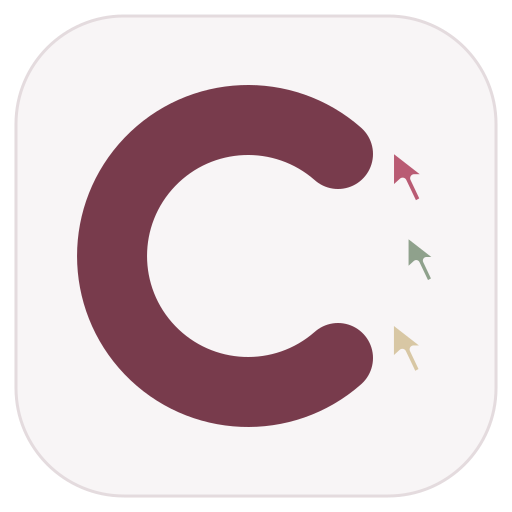
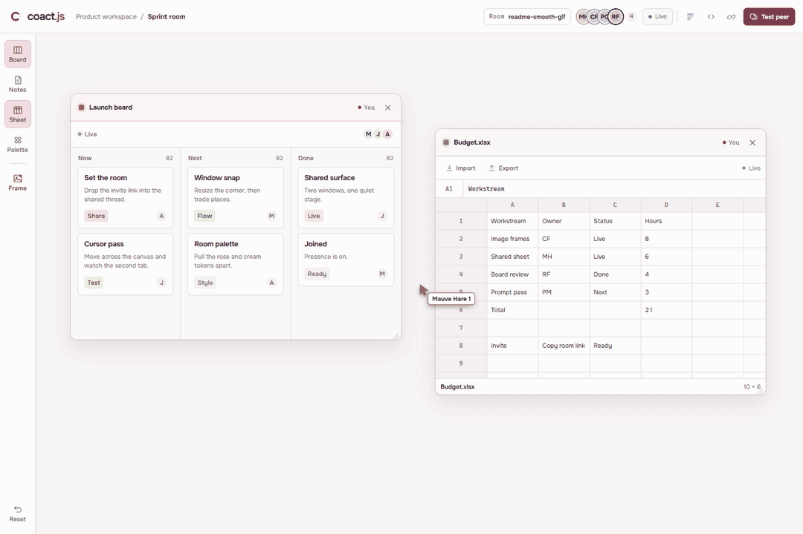

<p align="center">
  
</p>
<h1 align="center">Coact.js</h1>
<p align="center">Bring people onto the same canvas.</p>
<p align="center">
  <a href="https://www.npmjs.com/package/coactjs"></a>
  <a href="https://github.com/chiuwa/coactjs/actions/workflows/test.yml"></a>
  <a href="https://github.com/chiuwa/coactjs/blob/main/LICENSE"></a>
</p>



Shared cursors, windows, image frames and spreadsheet cells. A browser-native JavaScript component with TypeScript declarations and an optional synchronization server.

| ↗ Cursors | ▣ Windows | ◇ Frames | ▦ Cells |
| :--- | :--- | :--- | :--- |
| Live presence | Shared move & resize | Prompts & placeholders | Values & selections |

## Try it locally

```sh
npm install coactjs ws
npx coactjs
```

Open the printed URL, then **Open peer**. Node.js 20+. The local demo allows anonymous editing.

## Add to your app

```sh
npm install coactjs
```

```html
<coact-room id="canvas" style="display:block; height:80vh"></coact-room>
```

```js
import { createCoact } from 'coactjs';

const coact = createCoact('#canvas', {
  room: 'design-review',
  endpoint: '/ws'
});

coact.presence.subscribe(({ peers }) => console.log(peers));
```

Use a browser ESM bundler and connect `/ws` to a Coact server. The browser entry has no runtime dependencies; install `ws` for the Node server. Your app supplies authentication and its storage policy.

## Agent skill

Let your coding agent build with Coact.js:

```sh
npx skills add chiuwa/coactjs --skill coactjs
```

Then ask: “Use the coactjs skill to build shared cursors, draggable windows and an editable grid.” [View skill](https://github.com/chiuwa/coactjs/tree/main/skills/coactjs).

## Explore

[Integration guide](https://github.com/chiuwa/coactjs/blob/main/docs/guide.md) · [Examples](https://github.com/chiuwa/coactjs/tree/main/examples) · [Architecture](https://github.com/chiuwa/coactjs/blob/main/docs/architecture.md) · [Security](https://github.com/chiuwa/coactjs/blob/main/SECURITY.md) · [Resource limits](https://github.com/chiuwa/coactjs/blob/main/docs/resources.md)

Image frames provide placeholders until you connect a generation service. Cell synchronization is built in; the full demo supplies the grid and Excel import/export.

## Run the full demo

```sh
git clone https://github.com/chiuwa/coactjs.git
cd coactjs
npm ci
npm start
```

[Contributions](https://github.com/chiuwa/coactjs/blob/main/CONTRIBUTING.md) welcome. Built by [chiuwa](https://github.com/chiuwa).

**Apache-2.0** from v0.5.2. Published v0.5.1 remains MIT. [Third-party notices](https://github.com/chiuwa/coactjs/blob/main/THIRD_PARTY_NOTICES.md).
