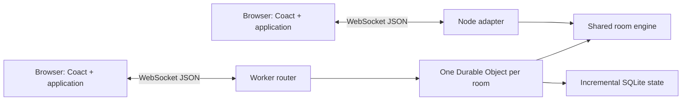

# Architecture

Coact.js has a browser component, a portable room coordinator, and runtime adapters. The full workspace is an application built on those pieces.

`src/coact.js` is the browser facade over `<coact-room>` in `src/coact-room.js`. It owns rendering, normalized geometry, cursor/peer state, bounded pending edits, leases and events. `src/protocol.js` shares schema/path rules with the server. `src/sheet-collection.js` is a cell adapter, not a generic document database. The browser entry requires the DOM; the existing `coactjs/core` alias is not headless.

`server/room.js` coordinates one room using runtime-neutral Web APIs. It compares touching path revisions, enforces leases/roles/resource limits, records bounded activity and prepares updates. Recent request receipts contain compact outcomes and digests rather than whole documents. A room serializes authorization and compare/commit, so asynchronous policy checks cannot race accepted mutations past the same revision.

`server/index.js` supplies Node HTTP/`ws`, Origin/auth upgrade checks, process-local room routing, connection limits, heartbeat and inactive-room cleanup. It does not serve an application unless given a handler. `server/cli.js` serves the small installed example; root `server.js` serves the repository's complete demo. The `ws` peer is optional and does not enter browser or Worker imports.

`server/worker.js` supplies a Worker router plus a Durable Object factory. A verified join reaches the room's named coordinator. The coordinator accepts hibernatable sockets and restores connection metadata from attachments. SQLite stores changed cells/objects, revision markers, bounded events and leases. A transaction completes before success packets are released. Cursor/selection/focus and delivery-credit updates avoid document writes. Connection checkpoints use short-lived timers, while alarms handle lease/hello/retention expiry; there is no permanent interval retaining idle objects.

Application-controlled data has byte and count budgets. Native output pressure also needs delivery accounting: updated peers negotiate packet sequences and acknowledge received data in batches. Pending credit contains compact sequence/byte groups, not copies of outgoing packets. Slow readers close at their window limit, and the state survives healthy socket hibernation. Broadcast JSON is prepared once, but network fan-out still grows with the number of peer pairs.

A successful client edit is queued with its input-time revision, transmitted once, and reconciled from the canonical ACK. Own ACKs can advance later drafts; another user's update does not silently grant permission to overwrite it. Conflicts restore the snapshot and expose rejected operations. The component waits for a prompt lease and current content before typing. Application-owned cells select their own locks and recovery UX. Queue failures leave local lifecycle state unchanged.

`demo/` provides the complete toolbar, board/note/palette examples, sheet grid, local SUM evaluator, bounded draft-copy notice and Activity drawer. The vendored SheetJS module is used only for gated demo import/export. `examples/basic` is shipped for an immediate installed-package experience; `examples/cloudflare` is a copyable Worker starter importing the public package. Root `worker/` plus `scripts/build-worker-assets.js` builds the complete demo's public assets. Test-only inspection RPCs are excluded from the npm package and production Worker entry.

Window content remains application-owned. HTML and arbitrary textarea data do not synchronize automatically. Custom actions are notifications; business effects need application authorization. Images are deterministic SVG placeholders, not uploaded/generated binary files.

Node ACKs commit memory, which is lost on process restart. Worker ACKs commit bounded SQLite room state, which survives reconstruction but is intentionally deleted after idle retention. The activity journal stores operation summaries and cannot reconstruct a workbook. Permanent document storage, external-file transactions, backups, rich-text CRDT and multi-runtime orchestration remain application responsibilities.

[Protocol](protocol.md) · [Resources](resources.md) · [Security](../SECURITY.md)
