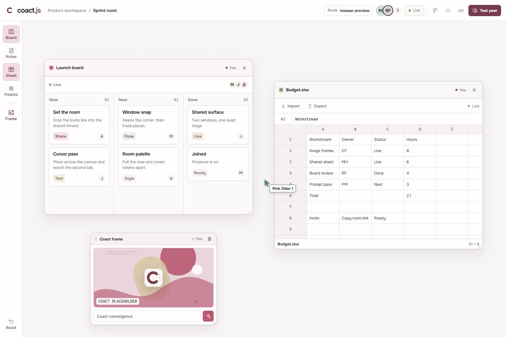

# Coact.js

Shared cursors, windows, image frames and cells for a collaborative browser canvas.



**Available on npm as `coactjs`.** The package includes the browser component, an optional Node server, a Cloudflare Durable Object adapter, and small examples. The full workspace demo and Excel parser stay in this repository.

## Start from an installed package

```sh
npm install coactjs ws
npx coactjs
```

Open the printed local URL, then **Open peer**. The installed example has shared cursors, a shared cell/window and image frames. `--port 4180` selects another port. The CLI binds to loopback by default and runs an anonymous local demo; it is not a private collaboration service.

For a browser-only application, install just `coactjs`. `ws` is an optional server peer, loaded only by `coactjs/server` or the CLI. Wrangler, Miniflare and TypeScript are development tools and are not installed as library runtime dependencies.

## Use the component

```html
<coact-room id="room" style="display:block; height:80vh"></coact-room>
```

```js
import { createCoact } from 'coactjs';
const coact = createCoact('#room', {
  room: 'design-review', endpoint: '/ws',
  maxPayload: 128 * 1024,
  maxPendingBytes: 512 * 1024,
  maxIncomingBytes: 1024 * 1024
});
coact.element.registerWindow('notes', {
  title: 'Notes', open: true,
  content: () => {
    const node = document.createElement('p');
    node.textContent = 'Application-owned window content.';
    return node;
  }
});
coact.presence.subscribe(({ self, peers, online }) => console.log(self, peers, online));
```

Configure during initial setup. To change rooms/endpoints, disconnect, change the element's attributes, then connect. A new room gets its own initialization grant; reconnecting to the same room restores its current state. Existing empty rooms stay empty.

The root entry is browser ESM using Custom Elements and Shadow DOM. `coactjs/core` remains a DOM-dependent compatibility alias. It is not a headless client or an SSR entry.

| Capability | Included | Application-owned |
| --- | --- | --- |
| Cursors / presence | Cursor rendering, positions, identities, subscriptions | Authenticated users and your avatar UI |
| Windows | Open, close, focus, move, resize | Window content and its data model |
| Image frames | Draw, prompt, geometry, deterministic placeholders | Actual generation API and file storage |
| Cells | Values, replacement, selection, sheet adapter | Grid UI, formulas and Excel I/O |
| Coordination | Queue, ACK/conflict/draft events, leases, delivery flow control | Recovery UX and durable app-specific documents |
| Activity / actions | Bounded journal, query metadata, custom notifications | Audit policy and business effects |
| Servers | Node API and Worker/Durable Object adapter | Authentication, membership and deployment configuration |

Arbitrary HTML or textarea contents do not synchronize themselves. `registerCollection()` adds a client adapter, not arbitrary server storage. Each room currently has one sheet cell map. Real image generation and full Excel/Word collaboration are outside this candidate.

## Save, handle drafts, and coordinate editing

```js
const sheet = coact.collection('sheet');
sheet.set('A1', 'Design review'); // Boolean: queued locally, not a save guarantee.
const unsubscribe = sheet.subscribe(cells => renderGrid(cells));
try {
  const ack = await coact.request('sheet', { action: 'cell', address: 'B2', value: 'Approved' });
  showSaved(ack.revision);
} catch (error) { showNotSaved(error.code); }
coact.on('coact:unsaved', event => keepDraft(event.detail.operations));
coact.on('coact:conflict', event => showConflict(event.detail.reason));
```

Every state mutation checks a revision. Independent cells can succeed concurrently; stale edits touching the same cell/object, whole-sheet replacement or reset conflict. The client sends one mutation at a time, detaches queued values from caller-owned objects, and coalesces unsent typing/movement samples. It advances later draft revisions only after its own ACK. Rejected or disconnected writes are not silently replayed.

`request()` returns a Promise for a state mutation. Explicit `baseRevision` is never rebased. Queue rejection reports `queue_full` or `payload_too_large`; convenience methods leave the local view unchanged if enqueueing fails. `coact:unsaved` exposes rejected/unconfirmed data for your recovery UI. Retain drafts under your own memory/storage budget before a page reload.

```js
coact.lock.acquire('sheet.B2');
coact.on('coact:lock', () => renderEditAccess(coact.locks, coact.self.id));
// Wait for an owned grant and sync current content before enabling typing.
coact.lock.release('sheet.B2'); // Touching pending edits settle before release.
```

Supported paths: `sheet`, `sheet.B2`, `window.notes`, `frame.<id>`, `frame.<id>.prompt`. Leases enforce ancestor/descendant protection, expire, renew, and release on disconnect. Tokens stay private. The component coordinates prompt and gesture leases; your own cell UI chooses its lock scope. Locks supplement mandatory revision checks.

```js
coact.action('review.requested', { documentId: 'brief-7' });
coact.on('coact:action', event => handleReview(event.detail));
coact.on('coact:journal', event => renderActivity(event.detail.journal));
coact.journalSince(lastSeenSequence);
console.log(coact.stats); // Counts and reserved pending bytes; not total browser heap.
```

Activity records meaningful changes, not cursor samples, focus or intermediate movement. Bulk changes store counts rather than full files. The journal is bounded by count and bytes and cannot reconstruct a document. `objects.set(id, { kind: 'window' | 'frame', ...geometry })` keeps the supplied id; use distinct ids across kinds. `Coact.adapters.sheet` exports the built-in adapter.

## Node server API

```js
import { createCoactServer } from 'coactjs/server';
const app = createCoactServer({
  mode: 'production', host: '127.0.0.1', port: 4174,
  requestHandler: applicationHandler,
  authenticate: request => sessions.verify(request.headers.cookie),
  authorize: context => membershipPolicy.check(context)
});
await app.start();
```

The example services above are yours to implement. Production mode requires both hooks. Authorization and role checks run on messages, including transport receipts. The default HTTP handler serves 404; mount your app explicitly. Node state is in memory, with room expiry and heartbeat cleanup. Node consumers using TypeScript need Node type declarations in their application.

## Cloudflare Workers

The pinned Wrangler development tooling requires Node.js 22.12+ (tested locally on Node 24); the Node server/CLI runtime still targets Node 20+.

The Worker adapter uses **one Durable Object per room**, hibernatable WebSockets, and SQLite-backed incremental storage. Cursor/selection/focus traffic does not write document rows. Accepted document edits and journal entries commit before their ACK/broadcast is released. Leases and connection metadata survive a room-engine reload; idle rooms expire after the configured retention period.

Copy the included starter into your application:

```sh
npm install coactjs
npm install --save-dev wrangler
node -e "require('node:fs').cpSync('node_modules/coactjs/examples/cloudflare','coact-worker',{recursive:true})"
cd coact-worker
npx wrangler dev
```

The starter imports `coactjs/worker`, builds assets from the installed package and includes the Durable Object binding/SQLite migration. Demo rooms are allowlisted and new joins have an edge rate-limit binding. Set your own rate-limiter namespace id when integrating with an existing account. Production apps must supply the same authentication/authorization policy options to both adapter factories. See [security](../SECURITY.md) and [resource limits](resources.md).

For this repository's complete workspace demo:

```sh
npm install
npm start                 # Node demo on 4174
npm run dev:worker        # Local Worker demo on 4175
npm run build:worker      # Build / dry-run only; does not deploy
```

Actual cloud deployment is a separate account-authorized step. Ordinary stateless Workers cannot coordinate a room with a process-local Map; other runtimes need a suitable stateful coordinator and transport adapter.

## Resource behavior and verification

Defaults include byte/count limits for documents, history, queues, message sizes, peers, and outbound deliveries. Slow readers are closed when their unacknowledged delivery window fills. Browser receipts are batched; Worker connection checkpoints use short-lived timers that finish after activity, with no permanent polling interval. See [measured resource behavior](resources.md) before changing profiles.

```sh
npm test
npm run test:types
npm run test:worker
# Browser tooling only:
python -m pip install playwright
python -m playwright install chromium
npm run test:browser
npm run test:client
```

The full demo limits imported files to 2 MiB and the first sheet/demo range. SheetJS is not in the npm package and file bytes are not sent over WebSocket. SDK queue limits do not bound application-owned undo history, image assets, spreadsheet parsing or event logs; those need their own budgets.

[Architecture](architecture.md) · [Protocol](protocol.md) · [Security](../SECURITY.md) · [Changelog](../CHANGELOG.md) · [Apache-2.0](../LICENSE)

## License

Copyright 2026 [chiuwa](https://github.com/chiuwa) and Coact.js contributors.

Version 0.5.2 onward: [Apache-2.0](../LICENSE). The previously published npm version 0.5.1 remains MIT-licensed. Third-party assets retain their own licenses; see [third-party notices](../THIRD_PARTY_NOTICES.md).
